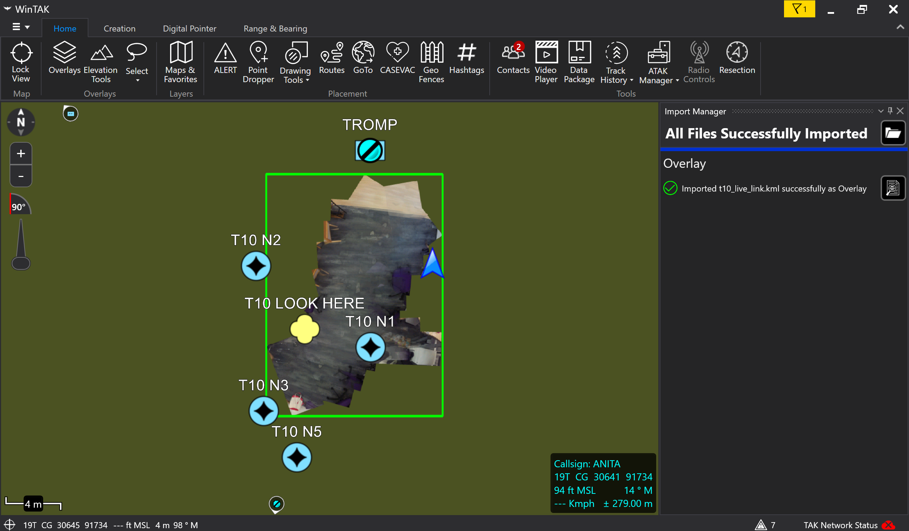
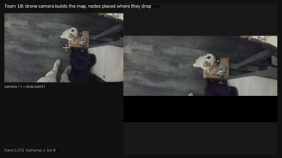
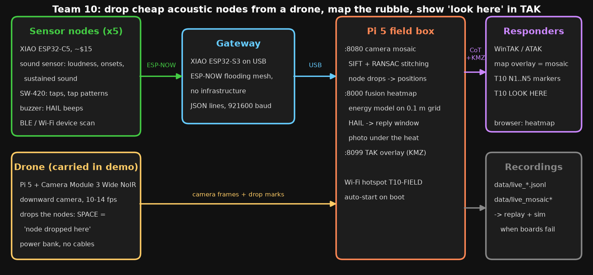
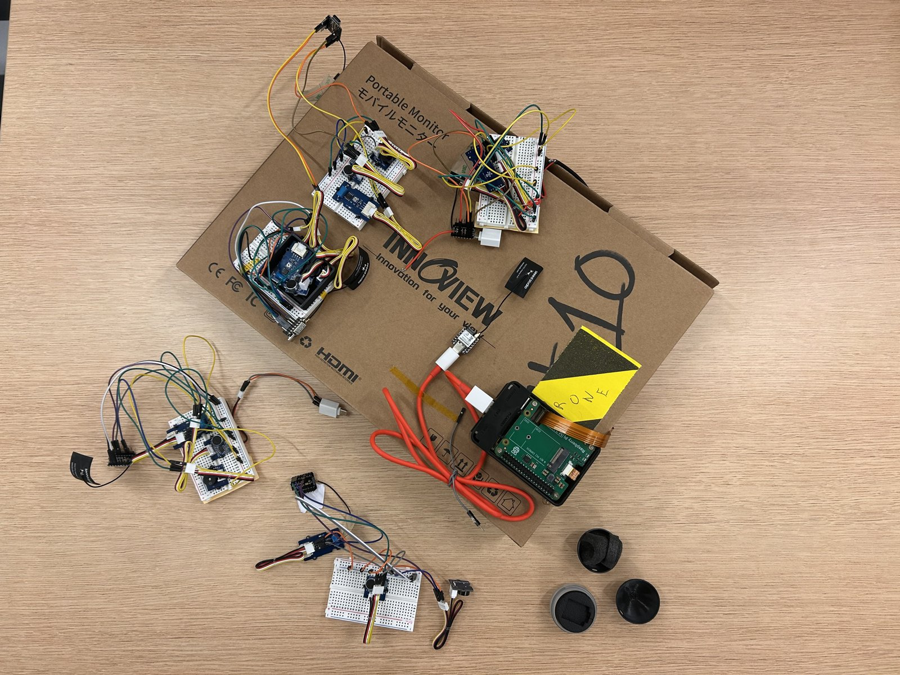
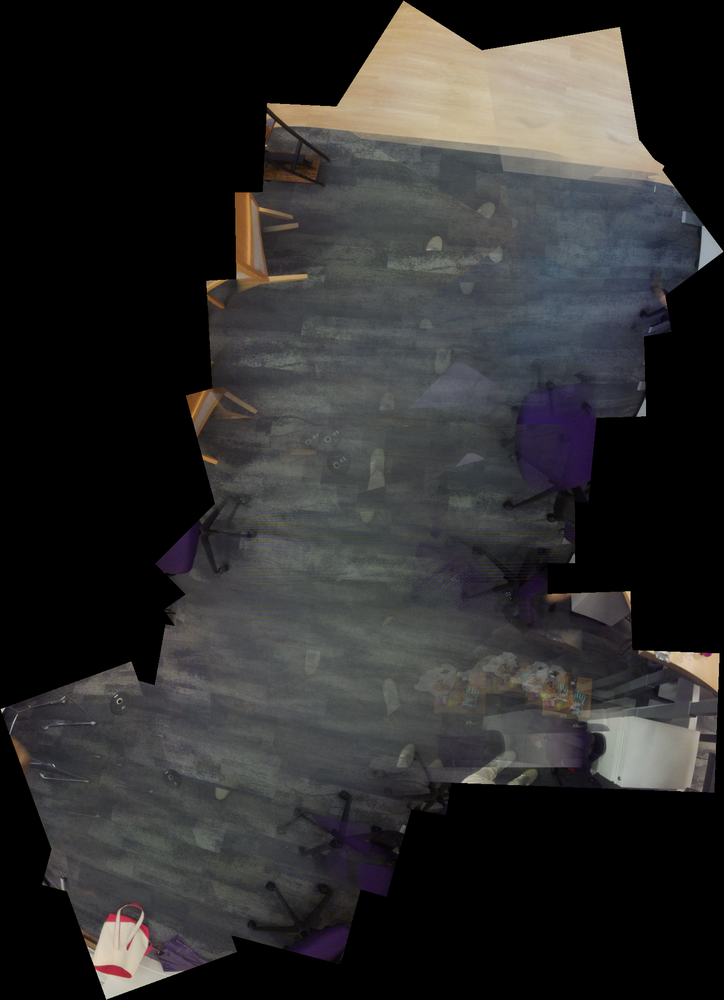
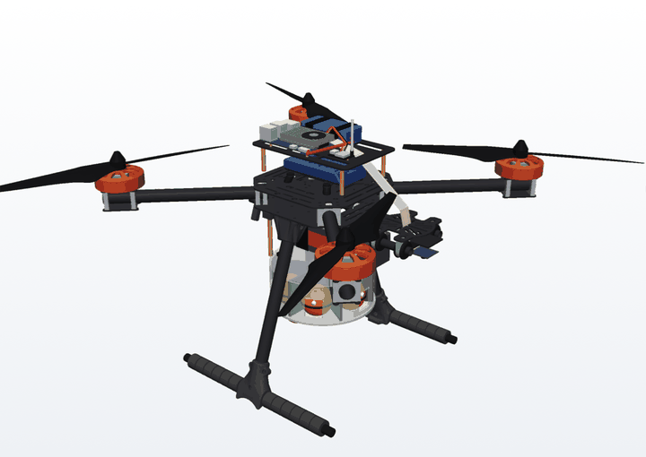
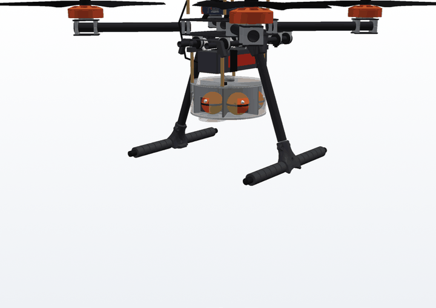
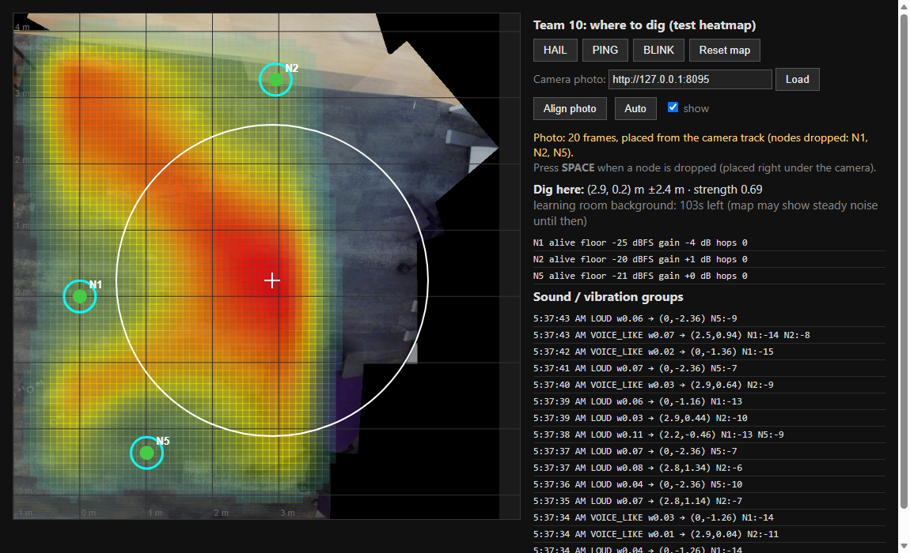
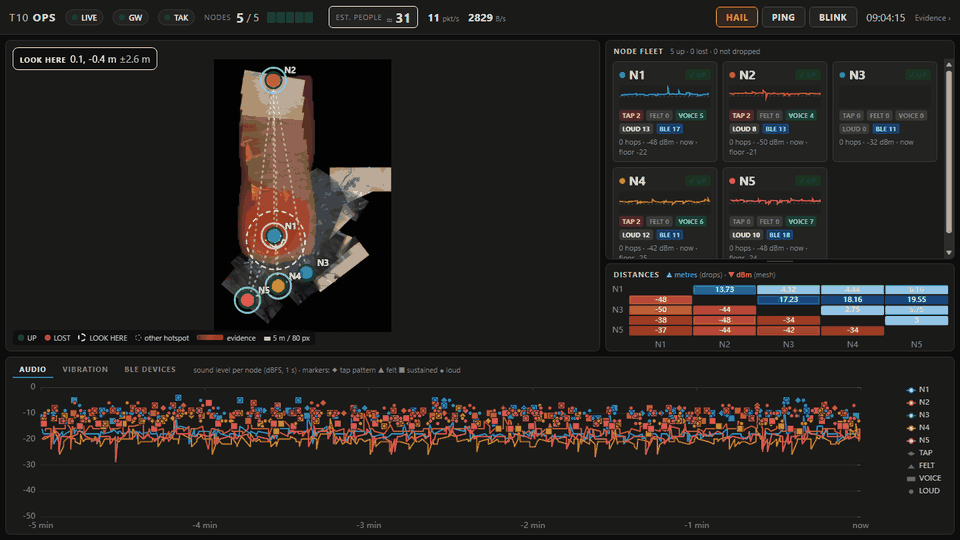
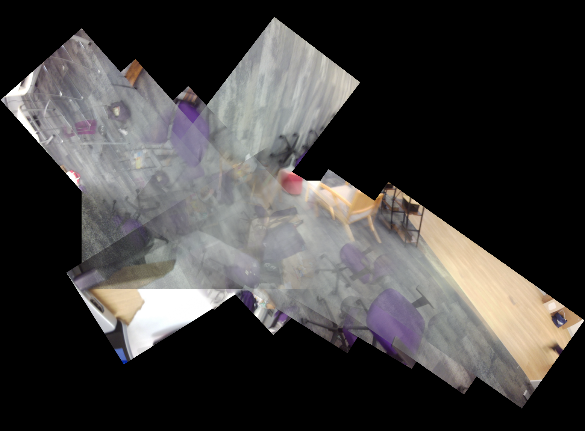

# Team 10: Operation Lost and Found

[Overview Slides](https://nam02.safelinks.protection.outlook.com/?url=https%3A%2F%2Fcanva.link%2Fwfmanuplspyfn6p&data=05%7C02%7CWilliam.Goldman%40tufts.edu%7C5ddcfdffb58546c256d008df3db8b6af%7Cfbbf6c6003444c299459725685739b19%7C0%7C0%7C639297535687245680%7CUnknown%7CTWFpbGZsb3d8eyJFbXB0eU1hcGkiOnRydWUsIlYiOiIwLjAuMDAwMCIsIlAiOiJXaW4zMiIsIkFOIjoiTWFpbCIsIldUIjoyfQ%3D%3D%7C0%7C%7C%7C&sdata=vJw0FBjeG%2BdhmEbMlkCNGhlRY4ZCowy9PIrv9aTBQHA%3D&reserved=0)

**Drop a handful of cheap acoustic sensor nodes onto a collapsed structure. They mesh with each other with no infrastructure, a drone camera maps the floor and records where each node landed, the nodes listen for trapped survivors (tapping, voices, phones), and a live "look here" picture appears in TAK, the map responders already use.**

Code Metal Forge 2026, Team 10. Everything below was built between Sat Nov 7 10:00 and Sun Nov 8 12:00, except the open-source tools listed in [What existed before](#what-existed-before-this-weekend).



*WinTAK during a live run on the venue floor (2026-11-08). The floor map is the drone camera's mosaic, built live on the Pi and pushed into TAK as a georeferenced overlay. `T10 N1`/`N2`/`N3`/`N5` are real nodes, each placed where it was dropped. `T10 LOOK HERE` is the acoustic heatmap's peak. No GPS, no internet, no TAK server.*

---

## Contents
1. [The problem](#1-the-problem)
2. [What the system does](#2-what-the-system-does)
3. [Technical systems](#3-technical-systems)
4. [Easy integration](#4-easy-integration)
5. [Adaptability: with or without GPS, and other scenarios](#5-adaptability)
6. [Deployability: cost, power, bandwidth, reliability](#6-deployability)
7. [Prototyping and design process](#7-prototyping-and-design-process)
8. [What works, what doesn't, what's unfinished](#8-what-works-what-doesnt-whats-unfinished)
9. [Run it](#9-run-it)
10. [Repository map](#10-repository-map)

---

## 1. The problem

After a building collapses (a missile strike or an earthquake), survivors are trapped in voids under the rubble. Today's search is slow, point by point, and puts people on unstable debris:
- **call-out-and-listen:** everyone goes quiet, someone shouts, and searchers listen for tapping;
- **a few expensive acoustic or seismic listening devices**, placed one position at a time by specialists;
- **search dogs**, and **cameras on poles** pushed into voids.

At the same time, **GPS does not work inside or under the structure, cell networks are down, and fixed comms are gone.** Responders already carry TAK (ATAK on phones, WinTAK on laptops).

**Our edge:** a disposable sensor mesh, about $15 a node, that turns the whole debris field into one listening array at once, and puts the result on the map responders already have open. We put nothing on the victim, and we trade precision for portability and cost: the goal is metre-level "look here" guidance, not centimetres.

## 2. What the system does

| Step | What happens | Built with |
|---|---|---|
| **1. Drop** | A drone (hand-carried for the demo) flies over the site with a downward camera. Each time a node is dropped, the operator presses SPACE. | Pi 5 + Camera Module 3 Wide NoIR |
| **2. Map** | The camera stitches a live top-down map of the floor. Each node is placed on that map exactly where it was dropped. | `drone/live_mosaic.py` (OpenCV) |
| **3. Mesh** | The nodes find each other over ESP-NOW and relay each other's packets. No router, no access point, no internet. | `firmware/node/node.ino` |
| **4. Listen** | Each node runs its own signal processing (noise floor, onsets, sustained sound, felt taps, tap patterns) and sends only small event packets, never raw audio. It also listens passively for phones and wearables. | ESP32-C5 + Grove sound sensor, SW-420 tap switch, buzzer |
| **5. Hail** | The operator presses HAIL: every node beeps ("tap if you can hear this"), then the network listens harder for 10 s. This automates the call-out-and-listen drill rescuers already use. | buzzer + fusion |
| **6. Fuse** | The field box combines all nodes' loudness into an evidence heatmap over the floor map and finds the strongest spot. | `fusion/heatmap.py` inside `fusion/server.py` |
| **7. Deliver** | TAK shows the nodes, the floor map and a `T10 LOOK HERE` marker. Browsers show the full heatmap and an evidence dashboard. | `fusion/tak.py`, `fusion/tak_overlay.py` |



*Walk 3 (Pi camera carried overhead, 372 frames) replayed through the stitcher: the live camera view with the drop crosshair, and the growing top-down map with N1, N2 and N5 placed at their drop points. Full video: [`media/video/mosaic_build_walk3.mp4`](media/video/mosaic_build_walk3.mp4).*



## 3. Technical systems

### 3.1 Sensor nodes (`firmware/node/`)

**Hardware per node:** a Seeed XIAO ESP32-C5, a Grove Sound Sensor (analog electret mic + amplifier) on D0, a Grove SW-420 vibration (tap) switch on D1, and a Grove Buzzer on D4, all powered from 3V3. The XIAO's 5V pin is dead on battery. Each node sits in a 3D-printed case: [`hardware/enclosure/node_case.py`](hardware/enclosure/node_case.py) is parametric CadQuery source, and the STLs are next to it. Every module lies flat in corner fences; the lid has openings over the mic and buzzer, a USB-C slot for charging, and an antenna recess away from the battery.

**On-board signal processing.** One Arduino sketch builds all three roles (node, gateway, drone bridge) for both the C5 and the S3:
- The sound sensor is sampled at **16 kHz by the ADC DMA driver**, in its own FreeRTOS task. The C5 is single-core, and the 2 s BLE scans would otherwise block the main loop.
- **Level** per 10 ms frame is the mean absolute deviation around a ~1 s running average, in dBFS. This is robust to the sensor's clipping (see §7). The **noise floor** follows quiet frames quickly and loud stretches slowly (~5 s).
- **Events**, each sent the moment it's detected, with its strength:
  - `LOUD`: an onset ≥ floor + 10 dB and ≥ 6 dB above the previous frame. Onsets within 250 ms merge, so a noisy room can't flood the mesh.
  - `VIBRATION`: a burst of SW-420 edges. The edge count is a strength proxy: light tap ≈ 2–6, hard hit ≈ 50–255.
  - `VOICE_LIKE`: *any* sustained sound (≥ floor + 6 dB for ≥ 400 ms). Voices, moaning and machinery all count. It is deliberately not a voice classifier.
  - `TAP_PATTERN`: ≥ 2 taps with 150–1500 ms gaps, from mic onsets and felt taps merged. Its `conf` rises with tap count, felt taps and regularity.
- **Policy: report every sound and every movement with its strength; fusion decides what matters.** No classification gates on the node, because in a collapse any sound matters, and only the fusion layer sees all nodes at once.
- **HAIL:** 3 × 150 ms beeps at 2.3 kHz. Each node ignores its own sensors until 2.5 s after its last beep, so its own and its neighbours' beeps are never reported as taps.
- **Passive phone/wearable detection, receive only.** BLE advertisements (2 s of every 10 s) and Wi-Fi probe requests are classified as `BLE_APPLE`, `BLE_FINDMY` (iPhones keep sending these for hours after power-off), `BLE_GOOGLE`, `BLE_OTHER` or `WIFI_PROBE`. They are reported as `DEVICE_SEEN` with **hashed IDs** (FNV-1a of the MAC plus a deployment salt); a raw MAC never leaves the node. This catches victims who are unconscious or too weak to tap, at $0 extra hardware.
- A `BEACON` every 2 s carries health (uptime, noise floor) and the node's neighbour list with signal strengths, which is the mesh graph.

### 3.2 Mesh (ESP-NOW flooding)
- Wi-Fi station mode, connected to nothing, fixed **2.4 GHz channel 1**; on the C5, forced to 2.4 GHz only. Packets are ESP-NOW broadcasts.
- **Flooding:** each packet has `(src, seq)`, `ttl` and `hops`. A node de-duplicates against the last 64 `(src, seq)` it has seen, and rebroadcasts with `ttl−1` after a random 0–20 ms jitter (starting TTL is 4). Packets therefore find their way around dead nodes with no routing table: the mesh repairs itself.
- **Downlink commands** (HAIL, PING, BLINK, transmit power, scan rate, salt) are flooded from the gateway, **sent 3× with the same sequence number** because ESP-NOW broadcast has no acknowledgement. That raised delivery on a weak link from occasional misses to 9/10.
- Transmit power is adjustable by command, to force multi-hop relaying on a small floor. Multi-hop forwarding was observed (`hops=1`).
- **The message format is a written contract** ([`docs/ARCHITECTURE.md`](docs/ARCHITECTURE.md) §2): packed binary over the air, ≤ 250 bytes, and one JSON object per line from the gateway to the host.

### 3.3 Gateway
A Seeed XIAO ESP32-S3 Plus on USB to the field box. It converts mesh packets into JSON lines at 921600 baud and turns text commands from the host (`CMD HAIL 0 255`) back into flooded packets. It also re-broadcasts node settings every 15 s, so a rebooted node re-learns them; this was verified in 19 s. The same `protocol.h` is shared by every role.

### 3.4 The field box: Raspberry Pi 5 (`deploy/pi/`)
The Pi 5 with its camera and the gateway is a **self-contained field box**. It needs no laptop, no venue network and no internet:
- **Its own Wi-Fi network:** `T10-FIELD`, at 10.42.0.1. It runs on channel 11 so it doesn't collide with the mesh on channel 1, using NetworkManager's shared mode (DHCP built in).
- **Three systemd services that start at power-on** and restart themselves:

| Service | Port | What it serves |
|---|---|---|
| `t10-camera` | 8080 | `drone/live_mosaic.py`: camera, live mosaic, drop log (`/drops`, `POST /drop`) |
| `t10-heatmap` | 8000 | `fusion/server.py`: evidence dashboard `/`, heatmap `/heatmap`, TAK picture `/tak`, commands `POST /cmd` |
| `t10-overlay` | 8099 | `fusion/tak_overlay.py`: the floor map as a live TAK overlay (`/link.kml`) |

- **Every live run is recorded:** each gateway line goes to `data/live_<time>.jsonl`, with a `.meta.json` holding where each node was dropped. Any run can be replayed later through the same code (`--recording`), which is how the system is tested without hardware.
- One installer sets it all up: `sudo bash deploy/pi/install.sh` (packages, services, hotspot; safe to re-run). Settings, including the TAK origin and hotspot password, live in [`deploy/pi/t10.env`](deploy/pi/t10.env).
- Any device that joins `T10-FIELD` gets everything: a laptop with WinTAK, an Android phone with ATAK, or a plain browser.



### 3.5 Drone camera: live floor map and drop positions (`drone/`)
The drone payload is the Pi 5 with a **Camera Module 3 Wide NoIR**, pointing straight down. The available drone, a BetaFPV Cetus X, lifts only about 15–30 g, so for the demo the payload is **carried by hand at about 2.2 m to simulate flight**. The architecture is the same either way: the drone is just another node with a camera.

**Mosaic (classical computer vision, no training, runs live on the Pi):**
- Full-sensor 2304×1296 mode, scaled to 1280×720, then processed at 640 px wide.
- Autofocus locked at the floor distance. Short exposure (6 ms at gain 16) against motion blur.
- Contrast equalisation (CLAHE), **SIFT** features (1500 per frame), ratio-test matching, and a RANSAC fit of rotation + shift with **fixed scale**, because the camera stays at a constant height. Free scale drifted badly with hand wobble.
- **Frame-to-frame tracking**. A new keyframe is added to the map when the view has moved 25% of the frame width. When tracking is lost, the frame is re-localised against the last 8 keyframes.
- Feather blending. The bottom 30% of each frame is masked, because it shows the carrier's feet in a hand-carried demo.

**Drop positions:** pressing SPACE (on the heatmap page or the camera page) places the next node at the **camera's centre point** on the map.
- The first drop is the origin.
- The scale in metres comes from the camera height and its 102° field of view.
- So the nodes and the photo share one coordinate frame, and the photo needs no manual alignment.
- If a node is already reporting over the mesh, SPACE places that node; otherwise the configured drop order is used.

**Power-aware:** at full speed the Pi browned out on a USB power bank (undervoltage at about 4.63 V; red LED, network down). We measured with [`drone/fps_ramp.sh`](drone/fps_ramp.sh), which steps fps and threads while logging the 5 V rail:
- 14 fps with 4 threads kept the rail at ≥ 4.74 V;
- the default is **10 fps with 2 threads**, for margin.



**Flying it: the deployment concept** ([`hardware/drone_concept/`](hardware/drone_concept/)). A CAD concept of the real airframe:
- a Holybro X500 quadcopter, from PX4's open-source model;
- a top deck carrying the Pi 5, the ESP32 mesh bridge and a battery;
- the downward camera;
- a **six-chamber revolver magazine** under the frame. A small gear motor steps the rotor 60° to drop **one 40 mm spherical node at a time** through a hole in the floor.

The model is generated by `build_concept.py`, with printable parts as STLs. It's a concept: not load-checked, printed or flown.

| Turntable | One drop: the node falls, the rotor steps the next one over the hole |
|---|---|
|  |  |

### 3.6 Fusion: the evidence heatmap (`fusion/heatmap.py`)
The heatmap model runs inside the fusion host. Every gateway line goes to both the dashboard state and the heatmap, in the same process.

1. **Group:** events of the same kind from different nodes that arrive within **0.15 s** are treated as one sound. Sound crosses the floor in ~10 ms, plus mesh jitter. Each group is evaluated 0.6 s after its first event.
2. **Fit, per group, on a 0.1 m grid:** for a source at cell `p`, each node should hear `level_i = S − 20·log10(max(d_i, 0.3 m)) + g_i`, where `S` is the source strength (solved in closed form) and `g_i` a per-node gain learned online.
   - Nodes that heard it must fit their `peak_db`. A clipped reading (≥ −3 dBFS) is only a lower bound.
   - Alive nodes that heard *nothing* must be predicted below their own noise floor + 10 dB. Silence is evidence too.
   - A felt-only tap (SW-420) adds a ~0.7 m-wide term around that node, because the switch feels taps within about 0.5–1 m.
   - Misfit σ = 5 dB covers reflections, mic differences and clipping.
3. **Weight and accumulate:** a tap pattern or a felt vibration counts 1.0, a single loud sound 0.3, a sustained sound 0.2. Evidence decays with a **20 s half-life**.
4. **Change detection:** a slow **120 s background** of the same evidence is subtracted. A machine that runs all the time fades out, and a new knocking source stands out.
5. **HAIL boost:** events 3.5–13.5 s after a HAIL (the reply window, after the beeps end) count **2×**.
6. **Peak:** the strongest cell and an uncertainty radius. The peak is reported only while it is confident, and it clears itself when the evidence fades.



### 3.7 Operator views (browser, served by the Pi)
**Ops dashboard** (`:8000/`): one screen for the operator, usable alongside or instead of WinTAK. It is graphics first: almost no text, short numbers.



*Live on the Pi field box with all five nodes on the venue floor: selecting a node highlights it on the map, its card and the graphs; then the Vibration and BLE tabs. Stills: [`ops_dashboard.png`](media/screenshots/ops_dashboard.png), [`ops_node_selected.png`](media/screenshots/ops_node_selected.png), [`ops_tab_vibration.png`](media/screenshots/ops_tab_vibration.png), [`ops_tab_ble.png`](media/screenshots/ops_tab_ble.png), [1366×768](media/screenshots/ops_dashboard_1366.png).*

- **Main panel, the map:** the camera mosaic, the evidence heat, nodes in their own colour with a green (up) or red (lost) ring, mesh links (brighter = stronger), a pulsing **LOOK HERE** ring with its ± radius, and a HAIL countdown while the network listens.
- **Header:** data source, gateway and TAK links, **nodes operational / dropped** as a segmented bar (plus nodes heard but not dropped yet), **EST. PEOPLE**, packets and bytes per second, and **HAIL / PING / BLINK**.
- **EST. PEOPLE (rough):** one number in the header, the largest of three channels over the last 60 s:
  - **sound:** separate evidence hotspots on the map (≥ 50% of the main peak, ≥ 1.5 m apart, with a valley between; secondary ones drawn as small numbered rings; not counted during the 2 min warm-up);
  - **vibration:** separate spots where nodes felt taps (nodes within 1.5 m grouped);
  - **phones/wearables:** unique nearby personal devices ÷ 1.5.

  The channels overlap, so they aren't added. The number is smoothed over 10 s. It is a planning number, not a headcount (`fusion/people.py`).
- **Node fleet** (drag the handle between the fleet and the matrix to resize them): one tile per node, with status, a 60 s audio-level sparkline, cue counts for the last 30 s (TAP, FELT, VOICE, LOUD, BLE devices), hops, link dBm and last-heard age.
- **Distance matrix:** metres between drop positions above the diagonal; mesh link strength in dBm (the mean of both directions) below it.
- **Sensor graphs, last 5 min, all nodes:**
  - **Audio:** sound level per node, with tap / felt / sustained / loud markers.
  - **Vibration:** SW-420 events per node, dot size = strength (switch edges), plus tap patterns.
  - **BLE:** phones and wearables heard per node per scan, with the strongest dBm and kinds on hover.

  Click a node on the map or its tile to highlight it everywhere. `?tab=vib` or `?tab=ble` opens a screen on one tab.
- Data: `GET /ops`, one JSON per second (`build_ops` in `fusion/server.py`; rolling series in `fusion/history.py`).

**Heatmap page** (`:8000/heatmap`): the same map with drop control (**SPACE**), manual photo alignment, and a log of every sound group showing which nodes heard it.

**Evidence review** (`:8000/review`): the full detail of each observation (raw event, timing, signal, sequence), a timeline by node, and SQLite history.

### 3.8 TAK integration (`fusion/tak.py`, `fusion/tak_overlay.py`)
- **Markers:** plain **Cursor-on-Target XML over UDP**, standard library only. There is no plugin, no TAK Server and no `pytak`.
  - Each node is a friendly ground sensor, `T10 N<id>`, or `T10 N<id> LOST` when it stops reporting. Its last cue and the time go in the marker's remarks.
  - The heatmap peak is an unknown contact, **`T10 LOOK HERE`**, with its uncertainty as the circular error and "Not a confirmed location" in the remarks.
- **Floor map in TAK:** the camera mosaic becomes a KMZ GroundOverlay (black is made transparent), served behind a KML NetworkLink that TAK re-fetches every 5 s. **When the operator presses SCAN DONE → TAK** (ops dashboard or camera page), the Pi freezes the mosaic and WinTAK's background fills in with the finished room within ~5 s: no download, no upload, and never a half-built map. Pressing again after more flying republishes (`--source live` on the overlay follows the growing mosaic instead). The overlay and the markers use the same local→lat/lon transform; the two were checked to agree within 0.06 cm.
- **Coordinate frame:** everything is computed in local metres, `(x, y)`, with the origin at the first drop. TAK needs only an origin `(lat0, lon0)` and a heading:
  - `east = x·cos h + y·sin h`, `north = −x·sin h + y·cos h`;
  - `lat = lat0 + north/111 320`, `lon = lon0 + east/(111 320·cos lat0)`.
- **Hardened against WinTAK's real-world behaviour:** WinTAK crashes if a marker is updated while its details pane is open, and we reproduced this twice. So each item has **one fixed ID and a fixed callsign**, and it is re-sent only on a real change (lost/back, the peak moving 0.3 m) or every 20 s. Stale markers clear themselves.
- Output goes to `127.0.0.1:4242` (WinTAK on the same laptop) or, with `--multicast`, to the standard SA channel **239.2.3.1:6969**, so every TAK device on the network sees it. `--iface` selects the network to send on, needed on the Pi's own hotspot.

## 4. Easy integration

- **It plugs into what responders already run.** Output is standard CoT into WinTAK, ATAK or iTAK: standard symbols, a standard overlay format (KML/KMZ), and the standard SA multicast channel. Responders learn nothing new, and every TAK user on the network can see the markers, share them and route to them. This follows the panel's advice: "don't bring a new widget, integrate."
- **One documented data contract.** The gateway prints one JSON object per line ([`docs/ARCHITECTURE.md`](docs/ARCHITECTURE.md) §2, host rules in [`docs/TELEMETRY_CONTRACT.md`](docs/TELEMETRY_CONTRACT.md)). Anything that can read a serial port, a TCP socket or a file can consume it. The same parser reads all three.
- **The TAK bridge is one adapter function.** `tak.py` polls a JSON picture (`/tak`) and knows nothing about acoustics. A different estimator, another team's sensor or a different backend only has to produce `{"nodes": [...], "sources": [...]}`.
- **Hardware-independent from the gateway down.** A simulator ([`sim/`](sim/)) and recorded runs ([`data/`](data/)) emit exactly the gateway's lines, so the fusion host, dashboard, heatmap and TAK all run with no boards. A dead board can't sink the demo. 92 automated tests cover parsing, state, recording, replay, commands, the TAK picture and the pages.
- **Small, ordinary dependencies:** Python 3.11+, NumPy, OpenCV, FastAPI/uvicorn, pyserial; Arduino-ESP32 core ≥ 3.3 for the firmware. It runs the same on a Windows laptop, a Mac or the Pi.
- **Any number of nodes.** Nodes join by being heard, and are placed by being dropped. The system builds a network of however many are deployed (the demo ran 4).

## 5. Adaptability

### 5.1 With GPS or without it: the system works either way
GPS only ever supplies **three numbers**: the origin latitude, longitude and heading that pin the local map to the globe (`T10_LAT`, `T10_LON`, `T10_HEADING` in `deploy/pi/t10.env`). Everything else (drop positions, the floor map, the heatmap, the TAK markers and overlay) is computed in **local metres from the camera**. So losing GPS doesn't break anything, and gaining GPS doesn't require any change to the pipeline.

| | **GPS-denied** (indoors, under rubble, jammed). **This is what the demo runs.** | **With GPS** (drone above the structure) |
|---|---|---|
| Where nodes are, relative to each other | Drone camera: each node at its drop point on the live mosaic | Same, from the camera |
| Where the map sits on the globe | The operator sets the origin once: a known point, or the command post's coordinates (we use the venue's), plus heading | The drone's GPS fix at the first drop gives the origin; its track gives the heading. *(Design: no GPS module was available, so this isn't built)* |
| Accuracy | Relative positions to the camera's accuracy (~10 cm in the synthetic test); absolute placement as good as the chosen origin | Absolute placement to GPS accuracy (~3 m); relative positions still from the camera |
| TAK picture | Identical | Identical |

The same layering continues if the camera is gone. Node localization is a **PACE plan** (primary, alternate, contingency, emergency):
- **Primary (built):** the drone camera's drops. With GPS, also absolute anchors.
- **Alternate:** acoustic ranging. The buzzer chirps as the radio packet goes out, and neighbours time the sound's arrival, giving node-to-node distances. It's in the message contract (`CHIRP`/`RANGE`) but cut from the demo, because the clipped sensor makes timing unreliable.
- **Contingency:** signal-strength ranging plus the neighbour graph. We measured it, and it only tells us who is near whom, not distances (see §7).
- **Emergency (built):** hand-measured positions, `--pos 1=0,0 --pos 2=3,0 …`.

### 5.2 Every layer has a fallback
| If this fails… | …the system still works like this |
|---|---|
| The drone camera | Hand-measured `--pos`; heatmap and TAK unchanged |
| The Pi | The laptop runs the identical command (`python -m fusion.server --gateway COMx ...`) |
| TAK | The browser pages show everything (heatmap, map, evidence) |
| A node | The mesh routes around it; TAK marks it `T10 Nx LOST`, and its silence still counts in the heatmap |
| All hardware | The simulator or a recorded run drives the full pipeline (`--demo`, `--recording`) |
| Venue network or internet | Never used: the Pi brings its own Wi-Fi |

### 5.3 Other scenarios
The building blocks are generic: dropped cheap nodes, a mesh with no infrastructure, events instead of raw streams, a camera that maps and places them, and TAK output. So the system adapts by changing parameters rather than code:

| Scenario | What changes |
|---|---|
| Earthquake / strike collapse (the demo) | Nothing |
| **Mine or tunnel collapse** | No GPS ever, so the PACE layers do the work. Longer mesh chains via TTL |
| **Avalanche / landslide** | Phone detection (`DEVICE_SEEN`: Find My, Fast Pair) matters more than taps. The GPS anchor works outdoors |
| **Wide-area or wilderness search** | GPS drops; the RF layer; the multicast SA channel to every searcher's ATAK |
| **Perimeter / denied-area monitoring** | The same event mesh, reporting footsteps and vehicles; HAIL off |
| **Different sensors** | The contract has reserved event kinds (`RADAR_PRESENCE`, `GAS`, `MOVED`). A mmWave breathing radar or a gas sensor adds a kind, and fusion weighs it; no format change |

## 6. Deployability

- **Cost:** about **$12 per node** in production bulk (ESP32-C5 module $3, MEMS mic $1, buzzer/LED/tap switch $0.50, 400 mAh LiPo $2, moulded shell $2, PCB/assembly $3), or ~$15 with a radar. The nodes are expendable by design.
- **Power (estimates, from datasheet currents):**
  - a node with the radio always receiving draws about 80–100 mA, so ~4 h on 400 mAh;
  - duty-cycling the radio (on for 100 ms per second, with the mic always on) brings it to ~20 mA, about 20 h.
  - The Pi field box runs from a USB power bank at the measured, brown-out-safe 10 fps.
- **Bandwidth:** about **45–60 bytes/s per node** (beacon, 1 Hz summary, events, device sightings), against **32,000 B/s** to stream raw 16 kHz audio, about **700× less**. Fifty nodes flooding is still ~110 kB/s, within ESP-NOW's capacity. Only events travel; the processing happens on the node.
- **Latency:** an event reaches the host in ~10 ms over the air (plus up to 2 s if a node is mid-BLE-scan), and is grouped and evaluated within 0.6 s. TAK is polled every 2 s.
- **Reliability:**
  - commands are sent 3× and de-duplicated;
  - stale markers clear themselves;
  - the services restart themselves;
  - every run is recorded for replay;
  - HAIL is refused while the gateway is unplugged, rather than beeping minutes late.
- **Off the laptop:** the fusion host already runs on the Pi 5, on its own network, starting at power-on. The path to production: a real drone release mechanism, a moulded self-righting shell, LoRa backhaul for larger sites, and encrypted, low-probability-of-intercept links. Security is out of scope for the hackathon.

## 7. Prototyping and design process

We built in thin, end-to-end slices: get one real signal all the way to TAK, then improve each stage, measuring as we went. Every significant decision is logged with its reason in [`docs/DECISIONS.md`](docs/DECISIONS.md). The timeline below comes from the commit history.

| When | Slice | What we learned or changed |
|---|---|---|
| Sat 13:00 | **Ideation.** Scenario: collapsed structure, for responders, nothing on the victim. Architecture: node processing, ESP-NOW flooding, energy heatmap, TAK first | The Friday panel shaped it: "integrate, don't bring a widget", "no batteries on people", "have a PACE plan" |
| Sat 13:45 | **Phone detection added** (BLE + Wi-Fi probes, hashed, receive only) | It detects victims who can't tap, at $0. Later measured: a phone touching a node read −33 to −39 dBm against a −59 to −66 background, but near the crowded laptop area dozens of phones were indistinguishable. So the demo keeps the "victim" node away from the crowd |
| Sat 15:00–16:30 | **First radio links, S3↔C5.** Gateway JSON. **Signal-strength calibration** on the floor | −40 dBm at 1 m, −46 at 2 m, −44 at 4 m and at 8 m: a path-loss exponent of ~0.3. **Signal strength can't measure distance at room scale**, so it became a weak term and a neighbour graph only |
| Sat 16:50 | **Sensor pivot:** we couldn't get the planned I2S MEMS mic, so we moved to Grove modules (sound sensor, SW-420, buzzer) | Lower audio quality, but parts in hand. All on 3V3, because the 5V pin is dead on battery |
| Sat 15:40–17:15 | **3D-printed node case**, parametric | All modules flat; the SW-420 glued to the case floor so it feels taps through the ground |
| Sat 20:40 | **Bench-tested the sound sensor** with a raw-sample sketch (`firmware/sensor_test`) | It's clipped at both ends at 3V3 (the LM386 is under-volted). Band energies were meaningless, so we **designed around it**: level from mean absolute deviation, a clip flag meaning "very loud", and the **SW-420 as the primary tap sensor** in loud rooms |
| Sat 21:30 | **Node firmware v3:** DMA audio task, events with strength, tap patterns, HAIL with self-blanking | "Report everything, let fusion weigh it." Five firm taps gave `TAP_PATTERN count=5 conf=80` |
| Sat 22:14 | **First 3-node live recording** (`data/live_3node_test1.jsonl`) and the first heatmap | It became the standard replay test |
| Sun 00:19 | **TAK bridge:** first markers in WinTAK at the right place and scale | WinTAK crashed twice when markers updated with a details pane open, which led to the fixed-ID, change-only update policy |
| Sun 02:09 | **One fusion host** (`server.py`): dashboard, heatmap, HAIL and TAK in one process | Two hosts were fighting over the serial port and port 8000 |
| Sun 03:38 | **Live camera mosaic on the Pi.** Walk 1: the Pi **browned out** on the power bank. Walk 2: hand **tilt ghosted the map** | Fixes: an fps cap and fewer threads (measured with `fps_ramp.sh`), focus lock and short exposure, frame-to-frame tracking with fixed scale, re-localisation. **Walk 3: 372 frames, 5 lost, built live** |
| Sun 04:16 | **Nodes placed by drops** (SPACE), and the mosaic under the heatmap | This replaced the cut LED-ID plan: the camera *is* the anchor |
| Sun 04:49 | **Mosaic in WinTAK** as a live georeferenced overlay | It updates as the drone flies |
| Sun ~05:30 | **Pi made standalone:** own hotspot, services at power-on, installer | The laptop only displays |
| Sun 07:12 | **Merged the dashboard branch with the camera branch.** The Pi runs one host | Reversed "TAK nodes only" to nodes + LOOK HERE once the camera made positions real; fixed callsigns for crash safety; refused late HAILs |
| Sun 07:30 | **Full live run:** 4 nodes dropped across the floor, a 31-keyframe map, LOOK HERE in WinTAK | The screenshot at the top of this page |
| Sun 08:13 | **Ops dashboard** at `/`: map, node fleet, distance matrix, per-sensor graphs; HAIL from the dashboard | The first dashboard was text-heavy, with no map. Operators want graphics and short numbers. The replacement N4 board was flashed and joined the mesh |
| Sun 08:40 | **EST. PEOPLE:** first as sound hotspots, then combined with felt taps and nearby phones | The first version said 5 on the live floor: a ridge between far-apart nodes had several bumps. A valley test fixed that. Phones then made it realistic for a crowded hall (≈ 30) |
| Sun 08:52 | **Drone deployment concept (CAD):** X500 with a six-chamber revolver dispenser | The X500's landing legs come within 72–75 mm of the centreline, which capped the magazine at 69 mm radius and the nodes at 40 mm |



**Process habits that paid off:**
- **A written message contract from hour one.** Firmware, simulator, dashboard and fusion were built in parallel against it.
- **A simulator and recordings for everything downstream of the gateway.** Most fusion and TAK work happened with no boards on the desk.
- **Measure, then decide.** Signal-strength calibration, the sensor bench test, the tap tests, and the Pi power ramp each changed the design.
- **Cut early:** LED-ID (only one bright LED available), acoustic ranging (clipped sensor), the accelerometer (6-bit, too coarse). Each was logged with its reason.

## 8. What works, what doesn't, what's unfinished

**Working, end to end, on real hardware:**
- C5 nodes with on-board detection;
- the ESP-NOW flooding mesh, including multi-hop;
- the S3 gateway;
- the Pi field box with its own Wi-Fi, auto-start and recording;
- the live camera mosaic;
- drop placement;
- the evidence heatmap with HAIL weighting;
- the dashboard;
- TAK markers and the live floor-map overlay in WinTAK.

**Measured:**
- Mosaic: walk 3 lost 5 of 372 frames; the synthetic walk with known ground truth has ~10 cm position error over 4 m.
- Pi camera: 14 fps is power-safe on a bank; 10 fps is the default.
- Overlay and markers agree to 0.06 cm.
- Command delivery: 9/10 on a weak link with the 3× send.

**Honest limits:**
- **The source-localisation metric (≤ 2 m, ≤ 15 s from HAIL) has not yet been measured** against tape-measured ground truth. In the 4-node live run the nodes were spread over ~8 × 14 m in a loud hall, and the LOOK HERE uncertainty was ±4.5 m. Nodes placed 2–4 m around the source tighten this.
- The sound sensor is clipped at 3V3, so it compresses loud, close sources. Keep test sources ≥ 1 m from nodes.
- In a crowded room the phone/BLE layer can't separate one phone from dozens. Device sightings appear on the dashboard but **aren't yet fused into the heatmap**.
- The gateway firmware reports the SW-420's `VIBRATION` events as `UNKNOWN` until it's reflashed. Fusion keeps them, but as unclassified.

**Not built (designed, in the contract or docs):**
- acoustic ranging (`CHIRP`/`RANGE`);
- camera LED-ID;
- the GPS module on the drone;
- the RF device heatmap layer and source counting;
- a flying drone release: the X500 revolver dispenser is a CAD concept (`hardware/drone_concept/`), not printed or flown, and the Cetus X can't lift the payload;
- encryption;
- `POST /anchor` and `/baseline`.

## 9. Run it

**The field box (Pi 5), one time, with internet** (over the Ethernet cable or venue Wi-Fi):
```bash
sudo bash ~/t10/deploy/pi/install.sh     # packages, 3 services, T10-FIELD hotspot; safe to re-run
```
After that, power it on. Join **T10-FIELD** and open:
- `http://10.42.0.1:8000` for the **ops dashboard** (map, fleet, distances, sensor graphs, HAIL);
- `http://10.42.0.1:8000/heatmap` for the heatmap + map (**SPACE** = drop a node);
- `http://10.42.0.1:8080` for the camera.

**WinTAK on a laptop joined to T10-FIELD:**
```bash
python fusion/tak.py --lat 42.35938882464616 --lon -71.05658046185967 --state-url http://10.42.0.1:8000/tak
```
Then, once per WinTAK install, import the overlay link `http://10.42.0.1:8099/link.kml` in WinTAK's Import Manager. After that the floor map appears in TAK by itself each time **SCAN DONE → TAK** is pressed. Demo rule: read a marker's details, then close the pane.

**No hardware at all** (any laptop, Python 3.11+, `pip install -r requirements.txt`):
```bash
python -m fusion.server --demo                                      # scripted gateway lines: dashboard + /heatmap + /tak
python -m fusion.server --recording data/live_3node_test1.jsonl     # a real 3-node run, replayed at recorded pace
python fusion/heatmap.py --sim --mosaic data/camera/walk3_mosaic    # physics simulator over the walk 3 floor map
python drone/live_mosaic.py --video "data/camera/walk3/%06d.jpg" --realtime   # replay a camera walk (frames not in git)
python -m pytest tests                                             # 92 tests
```

**Firmware:** `python tools/flash.py --port COMx --board c5|s3 --role node|gateway --id N [--ble]`. Wiring and bring-up: [`docs/HARDWARE.md`](docs/HARDWARE.md). WinTAK and Bambu Studio poll COM ports and break flashing, so close them first.

More: [`docs/DEMO_GUIDE.md`](docs/DEMO_GUIDE.md) (dashboard demo), [`docs/TAK.md`](docs/TAK.md) (TAK setup and demo rules), [`docs/PI_SETUP.md`](docs/PI_SETUP.md).

## 10. Repository map
```
firmware/node/      one Arduino sketch for every role (node, gateway, drone bridge) + protocol.h
firmware/sensor_test/  sound sensor / SW-420 bench sketch
hardware/enclosure/ parametric node case (CadQuery) + STLs
hardware/drone_concept/  drone deployment concept: X500 + revolver node dispenser (build_concept.py, STL/GLB, renders)
drone/              live_mosaic.py (camera, mosaic, drops), mosaic.py (stitcher), fps_ramp.sh (power test)
fusion/             server.py (the host), heatmap.py (model + page), history.py, people.py, state.py, serial_ingest.py,
                    tak.py (CoT), tak_picture.py, tak_overlay.py (map -> KMZ), recording.py, store.py
ui/                 ops.html/js/css (ops dashboard at /), index.html + review.js (evidence review at /review); ECharts + Tabler vendored
sim/                scripted gateway lines for the dashboard demo
deploy/pi/          systemd services, installer, settings (t10.env)
data/               recorded runs (replayable), camera mosaics, calibration data
media/              photos, screenshots, GIFs, video, diagram (see media/README.md)
tests/              92 tests (unittest/pytest)
tools/              flash.py, serial_tail.py, make_media.py, make_concept_gifs.py
docs/               architecture + message contract, sensors, hardware, TAK, decisions, demo guide
```

| Doc | What's in it |
|---|---|
| [`docs/PROJECT_BRIEF.md`](docs/PROJECT_BRIEF.md) | Problem, user, scenario, assumptions, demo metric, prior work |
| [`docs/ARCHITECTURE.md`](docs/ARCHITECTURE.md) | Components, **message contract**, algorithms, bandwidth budget |
| [`docs/SENSORS.md`](docs/SENSORS.md) | Every people-detecting sensor: physics, output, fusion use, limits |
| [`docs/HARDWARE.md`](docs/HARDWARE.md) | Boards, wiring, per-node parts and cost, power, bench results |
| [`docs/TAK.md`](docs/TAK.md) | TAK/CoT integration and demo rules |
| [`docs/DECISIONS.md`](docs/DECISIONS.md) | Every significant decision with its reason, and what worked or didn't |
| [`docs/TELEMETRY_CONTRACT.md`](docs/TELEMETRY_CONTRACT.md), [`docs/WS_CONTRACT.md`](docs/WS_CONTRACT.md) | Host field rules; the dashboard socket format |

## What existed before this weekend
- **Open-source tools and libraries:** Arduino-ESP32 core, ESP-NOW and the ESP32 BLE stack, Python, NumPy, OpenCV (SIFT, RANSAC, CLAHE), picamera2, FastAPI/uvicorn, pyserial, CadQuery, ECharts and Tabler (vendored in `ui/vendor/` with their licences), NetworkManager.
- **Standards and apps:** TAK (WinTAK/ATAK) and the Cursor-on-Target and KML formats. Our CoT and KMZ are written by our own code; `pytak` is not used.
- **No pretrained models are used.** The mosaic is classical computer vision, and detection is signal processing.
- **Prior work we built on:** Poudel & Assaad 2025 (ESP32 + MEMS microphone acoustic IoT on construction sites). We differ by using no Wi-Fi infrastructure, sending events instead of raw audio, **locating** the source across many nodes, and having the nodes placed by a drone camera.

Licensed under Apache-2.0; see [`LICENSE`](LICENSE).
