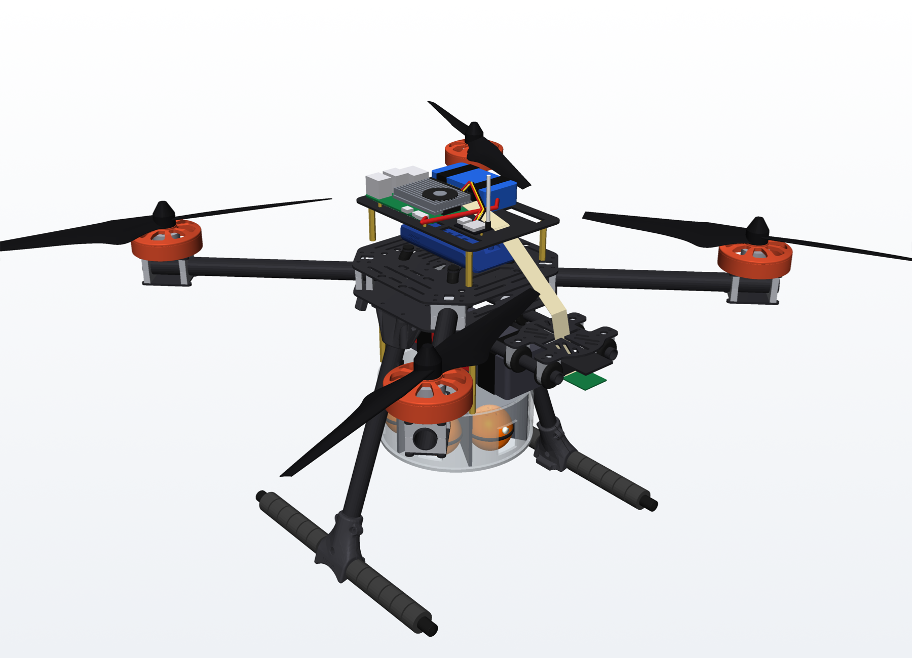
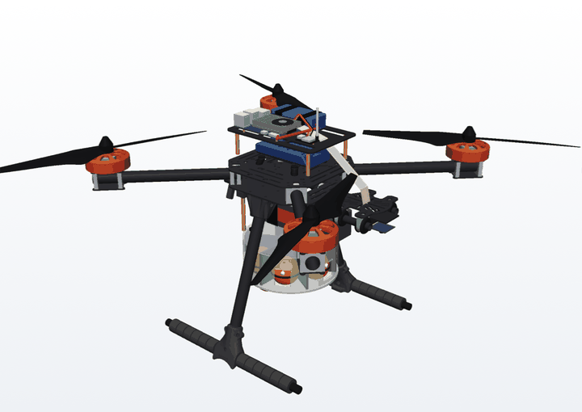
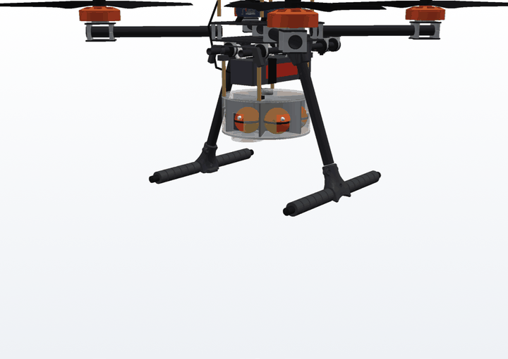

# Drone deployment concept (CAD)

A concept model of the full system: a commercial off-the-shelf quadcopter that carries six spherical sensor nodes and drops them **one at a time** onto a collapse site. It also carries the drone-side compute (Pi 5 + ESP32 mesh bridge) on a top deck.

This is a **concept, not a load-checked design**. Nothing here has been printed or flown. For the demo the drone role is still hand-carried (see `CLAUDE.md`).



| Turntable | One drop: the node over the hole falls, the rotor steps 60° |
|---|---|
|  |  |

Animations: `python tools/make_concept_gifs.py` (also writes `media/video/drone_concept_turntable.mp4`).

## What's in the model

| Part | Notes |
|---|---|
| Airframe | **Holybro X500** frame, 5010 motors and 13" props, from PX4's Gazebo model (existing open-source mesh, BSD-3, see below). Placed with PX4's `model.sdf` poses. |
| Top deck | 150 × 100 mm carbon plate on 34 mm standoffs above the flight controller. It carries a **Raspberry Pi 5** with active cooler, a **small ESP32-S3 board** (the drone's ESP-NOW mesh node) wired to the Pi's GPIO UART, and a **5 V battery pack** (strapped) that powers both from a USB-C lead. |
| Camera | Pi Camera Module 3, pointing straight down under the nose (overhead view for spotting the nodes' LED blinks), with a ribbon cable to the Pi. |
| Flight battery | 4S LiPo strapped to the X500 rails. |
| Dispenser | A 6-chamber **revolver magazine** hung from the rails under the battery. Its housing doesn't move: a top plate, a wall with viewing windows, and a floor with one drop hole aft. An N20 gear motor inside the rotor hub steps the finned rotor 60°. The nodes slide on the floor, and the one that reaches the hole drops through. One step releases one node. An index sensor on the top plate counts the steps. |
| Sensor node | 40 mm high-vis orange sphere with a seam band, a mic port, buzzer vents and an LED window. The model shows 5 nodes loaded and the 6th falling. |

Design constraint found while modelling: the X500's carbon landing legs angle in to **72–75 mm from the centreline** just below the rails. An 85 mm drum for 50 mm spheres would hit them, so the magazine is 69 mm radius (5 mm clearance) and the nodes are 40 mm. That's still enough room for an XIAO-class ESP32-C5/S3, a mic and a ~300 mAh LiPo.

## Files

| File | Use |
|---|---|
| `drone_concept_assembly.stl` | Whole assembly, one mesh (mm, Z up, X forward). |
| `drone_concept_assembly.glb` | Same, **with colours**. Opens in Windows 3D Viewer, Blender, or a glTF viewer. |
| `parts/<group>.stl` | Airframe, props, top deck, underside, dispenser, nodes, dropped node. |
| `parts/print_*.stl` | Custom printable parts at the origin: magazine top plate, wall, floor, rotor, deck plate. |
| `parts/sensor_node_sphere.stl` | One node shell. |
| `renders/*.png` | 8 views: iso, rear low, side, top, underside, dispenser close-up, top-deck close-up, exploded. |
| `build_concept.py` | Generates everything above. |

## Regenerate

```
python -m pip install trimesh manifold3d pycollada numpy scipy pyvista
python hardware/drone_concept/build_concept.py            # ~1 min, includes renders
python hardware/drone_concept/build_concept.py --no-render
```

On first run the PX4 meshes download into `vendor/` (about 24 MB, git-ignored).

## What existed before / attribution

- Airframe meshes: [PX4/PX4-gazebo-models](https://github.com/PX4/PX4-gazebo-models) `models/x500_base`, BSD-3-Clause, © PX4 Development Team. The licence is in `vendor/LICENSE_PX4`. The meshes are unmodified apart from scaling to mm and placement.
- Everything else (deck, dispenser, nodes, electronics stand-ins) is modelled in `build_concept.py`. Electronics are rough envelopes from published board dimensions (Pi 5 85 × 56 mm, etc.), not vendor CAD.
