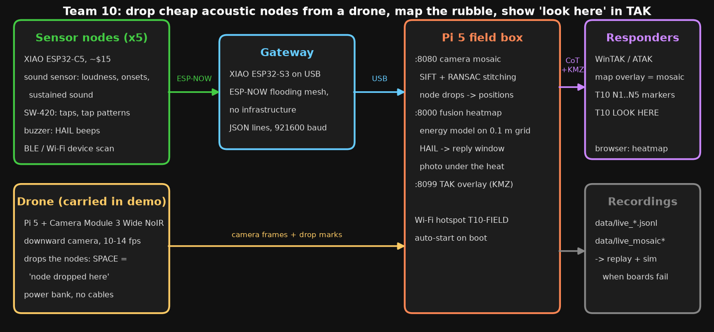
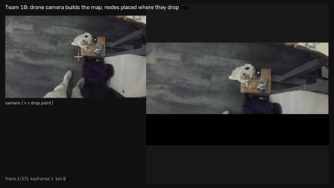
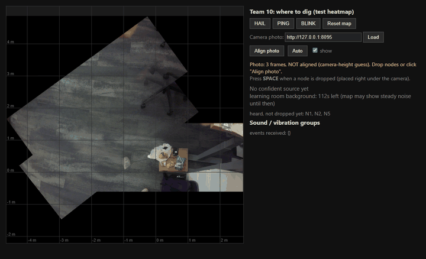
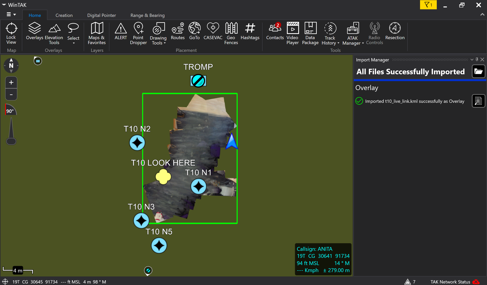

# Team 10 media

Pictures, screenshots, GIFs and video of what the system does so far (2026-11-08, before the PR #14 merge).
Everything except the photos and the WinTAK screenshots is generated from the repo, so it can be regenerated.

## The system


`diagrams/system_overview.png`: nodes → ESP-NOW mesh → gateway → Pi 5 field box (camera mosaic, fusion heatmap, TAK overlay, own Wi-Fi) → responders in WinTAK / ATAK.

## Hardware
| File | What it shows |
|---|---|
| `photos/hardware_angle.jpg` | Sensor nodes (XIAO ESP32-C5 + Grove sound sensor, SW-420 vibration switch, buzzer), the gateway, the Pi 5 "drone" with its downward camera, and the printed node shells |
| `photos/hardware_top.jpg` | Top view: three nodes, the XIAO ESP32-S3 gateway on USB to the Pi 5 (camera ribbon, "DRONE" tag), two loose nodes, node enclosures |
| `photos/hardware_side.jpg` | The full kit |
| `photos/node_closeup.jpg` | One node: ESP32-C5 with antenna, sound sensor, SW-420, buzzer |

## The drone camera builds the map, nodes are placed where they drop


| File | What it shows |
|---|---|
| `video/mosaic_build_walk3.mp4` | Walk 3 (Pi camera carried overhead, 372 frames) replayed through the stitcher: live frame with the drop crosshair, and the growing top-down map with N1, N2 and N5 placed at their drop points. 22 keyframes, 5 frames lost |
| `gifs/mosaic_build_walk3.gif` | The same, as a GIF |
| `mosaic/walk3_with_drops.png` | Its last frame |
| `mosaic/walk3_mosaic.png` | The mosaic the Pi built **live** during walk 3 |
| `mosaic/walk2_tilted_frames.jpg`, `mosaic/walk2_restitch.png` | Walk 2: hand-tilted frames gave a ghosted map. That taught us to point the camera straight down and track rotation and shift only |
| `mosaic/synthetic_mosaic.png` | Synthetic floor walk with known ground truth (`drone/test_mosaic_synth.py`), about 10 cm position error over 4 m |

## Heatmap (operator page, served by the Pi)


| File | What it shows |
|---|---|
| `gifs/heatmap_drops_live.gif` | Heatmap page while nodes are dropped (SPACE): each node appears where the camera was, the camera map sits under the heat, no clicking |
| `screenshots/heatmap_photo_and_drops.png` | The same, settled: evidence heat over the floor photo, nodes N1/N2/N5 at their drop points, estimate with uncertainty circle |
| `screenshots/ops_dashboard.png` | **The ops dashboard** (`/`): map with heat, nodes and LOOK HERE; fleet tiles (3/3 up); distance matrix (m / dBm); audio graph. 3-node hall recording + walk 3 camera replay |
| `screenshots/camera_page.png` | The Pi camera page: live frame with drop crosshair, drop list, growing mosaic |
| `screenshots/heatmap_real_3node_recording.png` | The heatmap on **real data**: the 3-node hall recording (`data/live_3node_test1.jsonl`) |
| `screenshots/heatmap_simulator.png` | The built-in simulator (taps from a hidden source plus room chatter) |

Note: these page screenshots predate the PR #14 merge; the page now says "where to look" / "Look here".

## TAK


| File | What it shows |
|---|---|
| `screenshots/wintak_mosaic_overlay.png` | **Live run, 2026-11-08 ~07:35:** WinTAK with the drone camera's mosaic as a live overlay; T10 N1/N2/N3/N5 placed by their drops; T10 LOOK HERE at the heatmap peak. Pi field box running `fusion/server.py`, no GPS, no internet |
| `screenshots/wintak_first_test_zoomed.png` | WinTAK, first TAK test (simulator): T10 N1/N2 node markers, N5 shown LOST, the heatmap estimate (then a search-area marker; now "T10 LOOK HERE") |
| `screenshots/wintak_first_test_venue.png` | Zoomed out over the venue: our T10 N1 next to other teams' markers on the shared SA network |


## Regenerate
```bash
python tools/make_media.py --photos <folder with the device photos>   # photos, mosaics, video, GIF, diagram
```
The page screenshots and `heatmap_drops_live.gif` need the servers running: camera replay
(`drone/live_mosaic.py --video data/camera/walk3/%06d.jpg --realtime`), `fusion/heatmap.py --sim --mosaic http://127.0.0.1:8095`,
drops via `POST /drop`, captured with headless Edge.
